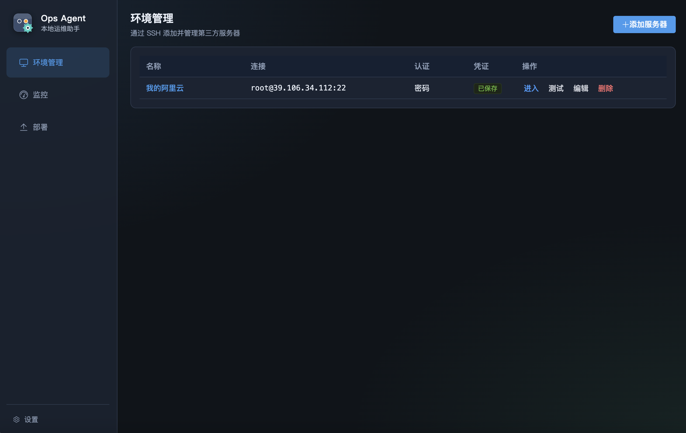
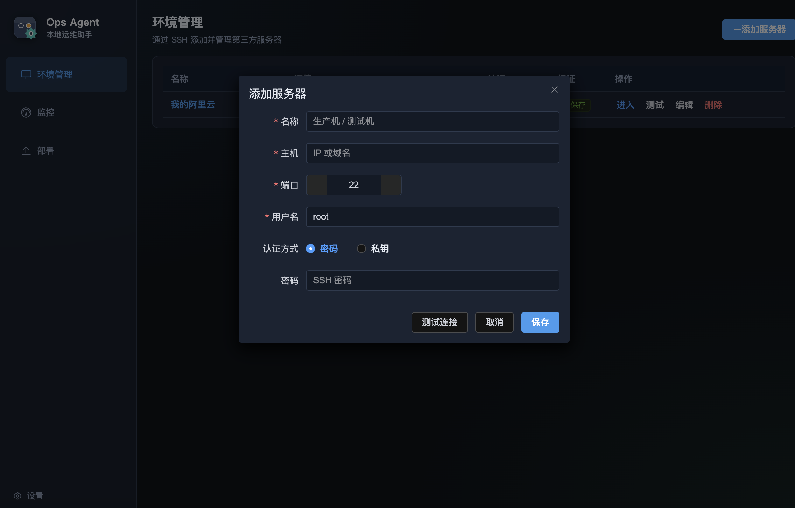
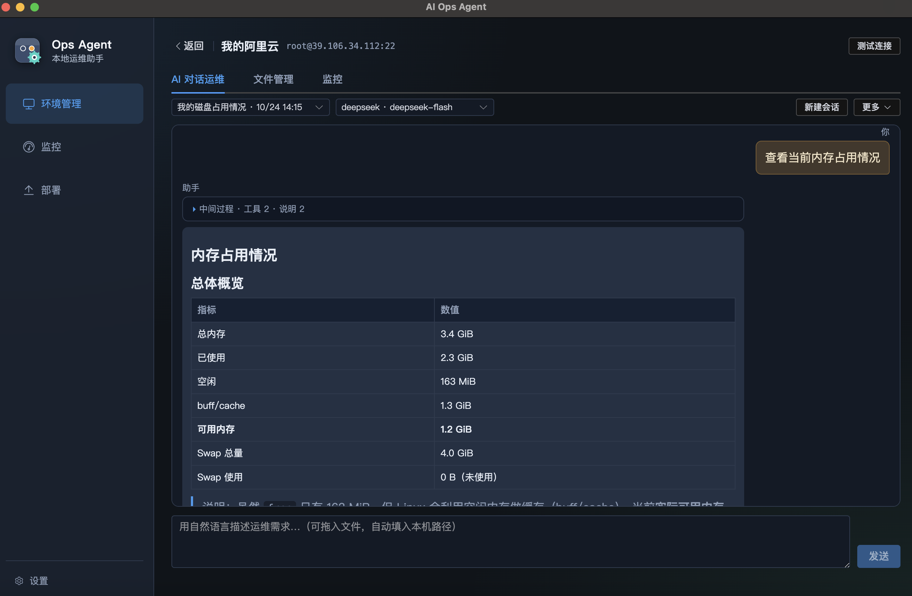
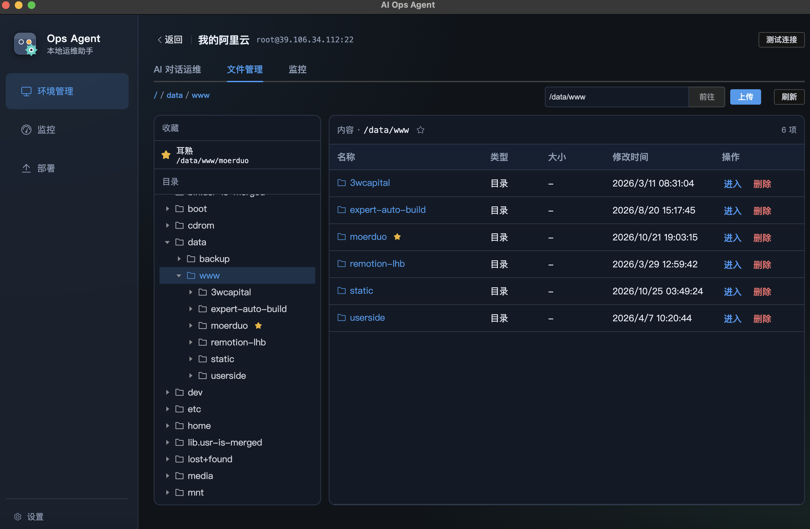
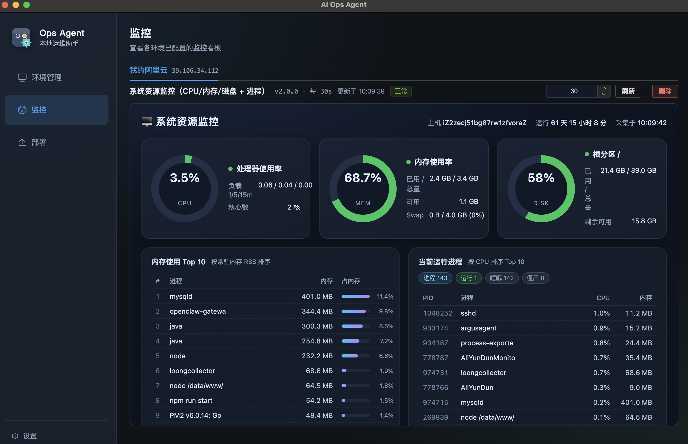
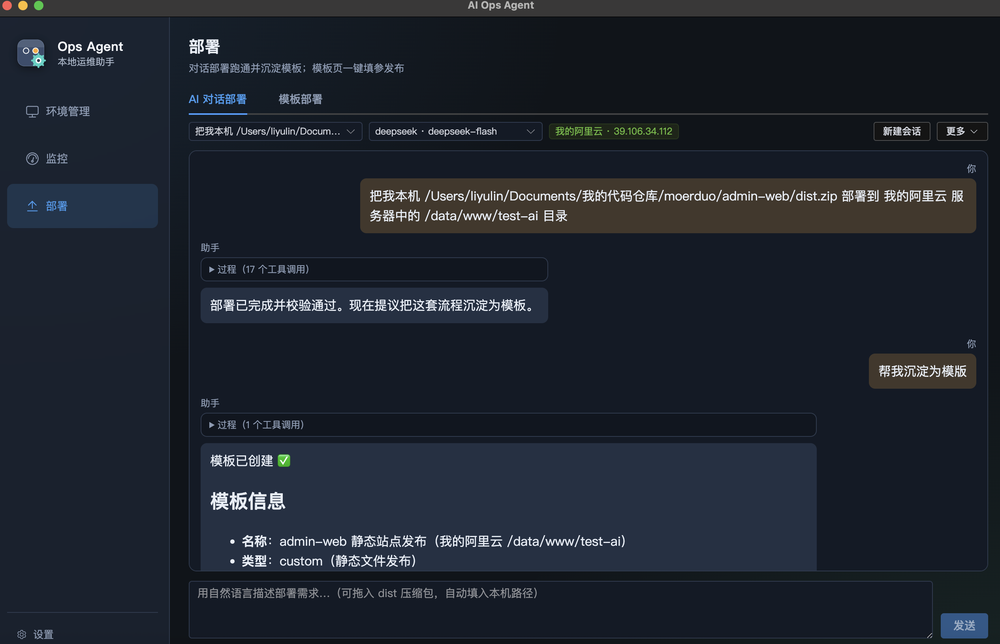
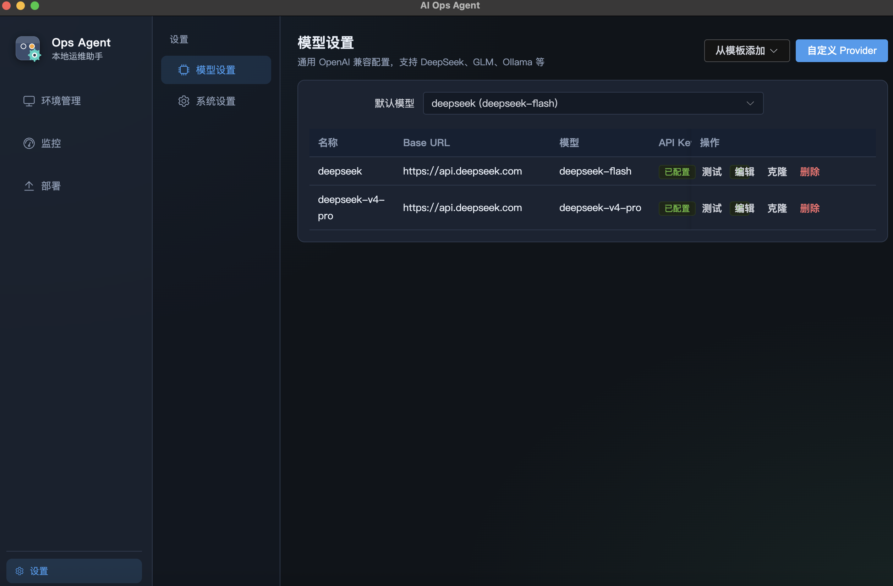

# AI Ops Agent

本地优先的 AI 运维桌面工具：用自然语言管服务器、看监控、做部署。

把 SSH 环境、LLM、对话运维、文件浏览、监控看板和部署模板收进一个 Electron 应用里——凭证只存本机，日常操作尽量少碰命令行。

<p align="center">
  
</p>

## 它能做什么

| 模块 | 说明 |
|------|------|
| **环境管理** | 添加 SSH 服务器（密码 / 私钥），测试连通性 |
| **AI 对话运维** | 自然语言查状态、装软件、改配置；高危命令拦截，写操作需确认 |
| **远程文件** | 目录浏览、上传、下载、删除 |
| **监控** | 对话生成看板后，运行时零 Token 轮询采集指标 |
| **部署** | 对话跑通流程并沉淀模板；日常填参发布，尽量不再消耗 Token |
| **模型设置** | OpenAI 兼容协议：DeepSeek、智谱 GLM、Ollama 等 |

---

## 界面预览

### 环境管理

管理多台服务器，支持密码与私钥认证。



### AI 对话运维

对某台机器用自然语言运维，Agent 通过工具调用执行 SSH 命令。



### 远程文件管理

像本地资源管理器一样浏览远端目录。



### 监控看板

AI 生成一次看板与采集脚本，之后本地定时拉取，无需持续烧 Token。



### 部署

先用对话把发布流程跑通并定版 Recipe，日常在模板页填参一键发布。



### 模型设置

配置任意 OpenAI 兼容 Provider，可设默认模型并测试连接。



---

## 快速开始

### 开发运行

```bash
npm install
npm run dev
```

### 打包

```bash
npm run build:mac    # macOS
npm run build:win    # Windows
npm run build:linux  # Linux
```

### 推荐使用流程

1. **设置 → 模型设置**：添加至少一个 LLM Provider，并设为默认  
2. **环境管理**：添加 SSH 服务器，测试连接  
3. 进入服务器 → **AI 对话运维** / **文件管理** / **监控**  
4. **部署**：对话跑通后沉淀模板，日常模板发布  

---

## 配置 LLM

打开应用 → **设置 → 模型设置** →「从模板添加」或「自定义 Provider」。

| 字段 | 说明 |
|------|------|
| Name | 显示名称 |
| Base URL | OpenAI 兼容地址，需包含 `/v1` 或厂商等价路径 |
| Model | 模型名 |
| API Key | 密钥（Ollama 可留空） |

**DeepSeek**：`https://api.deepseek.com/v1` · `deepseek-chat`  
**智谱 GLM**：`https://open.bigmodel.cn/api/paas/v4` · `glm-4-plus` 等  
**Ollama**：`http://localhost:11434/v1` · 本地模型名，API Key 可空  

```bash
ollama pull llama3.2
```

保存后点「测试连接」验证。

---

## 技术栈

- Electron + electron-vite  
- Vue 3 + TypeScript + Pinia + Vue Router + Element Plus  
- ssh2（主进程）  
- Electron `safeStorage` 加密存储 API Key / SSH 凭证  

---

## 数据与安全

**数据目录**（默认）：Electron `userData/data/`  
macOS 约在 `~/Library/Application Support/ai-ops-agent/data/`。

可在 **设置 → 系统设置** 更改数据目录；切换时可迁移现有数据。目录指针写在固定的 `userData/app-config.json`。

当前为 JSON 文件存储，包含：服务器、模型配置、聊天记录、监控与部署配方等。

**安全要点**：

- SSH 密码、私钥、API Key 仅存主进程，经 `safeStorage` 加密落盘  
- 渲染进程通过 `contextBridge` 白名单 IPC 访问能力  
- 高危命令（如 `rm -rf /`、`mkfs` 等）默认拦截；写操作需用户确认  

---

## 目录结构

```
src/
  main/       # Electron 主进程：SSH / LLM / Agent / IPC
  preload/    # contextBridge API
  renderer/   # Vue3 UI
  shared/     # 共享类型
docs/
  screenshots/  # 产品截图
```

---

## License

MIT
